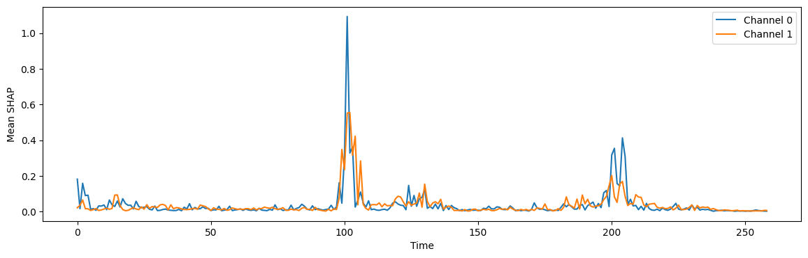

# Generalizable ECG Classification

A collaborative project exploring transfer learning between ECG datasets with a CNN–Transformer model.

This project page describes the team experiment and its recorded results. It does not claim sole authorship. Original notebooks, ECG recordings, datasets and model checkpoints are not distributed here.

## Method

- Pretrain a Conv1d feature extractor and Transformer encoder on 12-channel PTB-XL signals and five diagnostic superclasses.
- Transfer compatible feature weights to a two-channel, four-class MIT-BIH Long-Term ECG model. Initialize the input convolution and classification head for the new task.
- Normalize 259-sample beat windows and separate training, validation and testing by recording.
- Explore model behaviour using SHAP and attention visualizations.

The MIT experiment uses five training recordings, one validation recording and one held-out test recording. It is one holdout experiment, not five-fold cross-validation.

## Recorded results

| Measure | Recorded value |
| --- | ---: |
| Test beats | 49,630 |
| Test accuracy | 87.73% |
| Macro F1 | 0.44 |
| Normal-beat recall | 1.00 |
| Ventricular-beat recall | 0.49 |
| Fusion-beat recall | 0.00 |
| Supraventricular-beat recall | 0.10 |

F1 and recalls are rounded as printed in the notebook. These are saved outputs, not independently reproduced results.

The figure averages attribution magnitudes over five validation samples. It describes model behaviour, not signed effects or clinical causation.

## Evaluation limits

Accuracy hides weak performance for rare beat classes. Evaluation on one recording does not establish reliable performance across patients, sites or devices. No clinical validation is claimed. PTB-XL and MIT-BIH use different labels and input channel counts, so their classification tasks are not directly interchangeable.

## Tools

Python · PyTorch · WFDB · SHAP · scikit-learn · NumPy · Matplotlib

## Source evidence

Prepared from `group-project-generalizable-ecg-classification (1).ipynb`: model in cell 6; dataset splits in cells 19 and 28; transfer in cells 33–37; attribution plot in cell 41; final metrics in cells 46–47 (zero-based cell indices).
